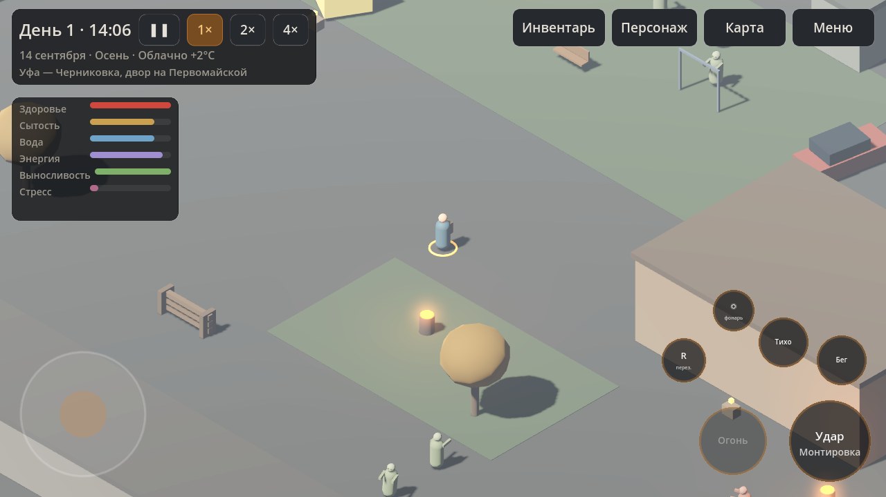

# ASHENFALL: UFA

Изометрическая survival RPG о зомби-апокалипсисе в Башкортостане. Godot 4.5, Android (landscape).

Сейчас это **этап 1 (технический фундамент) + первый играбельный прототип**, а не готовая игра.
Что реально работает и что ещё нет — в разделе «Статус» ниже и в [documentation/ROADMAP.md](documentation/ROADMAP.md).



## Что уже можно сделать в игре

- Начать новую игру во дворе Черниковки (Уфа), управлять героем виртуальным джойстиком или WASD.
- Драться монтировкой/топором/ножом, стрелять из ПМ и ИЖ-27 (патроны, перезарядка, разброс, износ, клин).
- Встретить 4 типа заражённых: бродяга, бегун, затаившийся (засада), омоновец (броня).
  У них есть зрение (конус + прямая видимость), слух (шум шагов и выстрелов), обоняние, память о цели, групповая тревога, реакция на фонарь ночью и на погоду.
- Обыскивать 12 точек лута и тела, следить за весом, едой, водой, сном, температурой тела, стрессом, болью.
- Получать кровотечения, переломы, ожоги, заражение раны и «пепельную лихорадку» (инкубация → жар → некроз → обращение), лечиться.
- Выйти на стратегическую карту Башкортостана (25 районов, реальные города, реки, трассы), путешествовать по дорогам, обыскивать районы, спать. Туман войны, миграция орд между районами.
- Сохраняться в 7 слотов, загружаться, пережить сбой (восстановление из автосохранения), получить отчёт об офлайн-прогрессе.
- Ставить пакеты контента из каталога сервера или из ZIP, обновлять их дифференциально, откатывать.

## Быстрый старт

```bash
# 1. Godot 4.5.1: https://godotengine.org/download/archive/4.5.1-stable/
godot --path . --editor            # открыть проект
godot --path .                     # запустить игру

# 2. Тесты (headless, изолированный user://)
GODOT=godot tests/run_tests.sh             # все наборы
GODOT=godot tests/run_tests.sh test_saves  # один набор

# 3. Проверка компиляции всех скриптов
godot --headless -s res://tools/check_scripts.gd

# 4. Android APK (нужны шаблоны экспорта 4.5.1, Android SDK 35, JDK 17+)
GODOT=godot ANDROID_SDK=$ANDROID_HOME tools/build_apk.sh debug
# -> build/ashenfall_ufa.apk ; установка: adb install -r build/ashenfall_ufa.apk

# 5. Сервер контента для разработки
pip install cryptography
python3 tools/afpkg.py build content_src/region_sterlitamak --out dist
python3 tools/afpkg.py build content_src/example_mod --out dist
python3 tools/afpkg.py serve --out dist --port 8765
# В игре: Контент и моды → Каталог. С эмулятора Android сервер доступен как 10.0.2.2:8765,
# с телефона — укажите IP компьютера в «Настройки → Сервер обновлений».
```

CI (`.github/workflows/ci.yml`) компилирует скрипты, гоняет тесты, собирает debug-APK и пакеты контента и выкладывает их артефактами.

## Статус

| Область | Состояние |
|---|---|
| Ядро: менеджеры, шина событий, настройки, профили производительности | ✅ работает, покрыто тестами |
| Игровое время (пауза-стек, скорости, календарь, сезоны) | ✅ |
| Планировщик симуляции: 3 уровня, бюджет кадра, «перемотка» | ✅ |
| SQLite (системная БД + БД на каждый слот) | ✅ |
| Сохранения: слоты, атомарная запись, SHA-256, резервные копии, миграции, сбой, офлайн-прогресс | ✅ |
| Пакеты контента: манифесты, проверка путей, контрольные суммы, RSA-подписи, атомарная установка, откат, зависимости, конфликты, порядок загрузки | ✅ |
| Загрузчик: каталог, зеркала, докачка (HTTP Range), очередь с приоритетами, пауза/отмена, скорость/ETA, переживает перезапуск | ✅ (проверено с локальным сервером) |
| «Только Wi-Fi» на Android | ⚠️ код через JNI есть, на устройстве не проверен |
| Моды: данные + декларативные правила-скрипты (песочница) | ✅ API v1 |
| Прототип: локация, герой, заражённые, бой, лут, потребности, травмы, инфекция, карта, путешествия | ✅ играбельно |
| Обновление кода игры без APK (подписанный .pck, Bootstrap, защита от неудачного запуска) | ✅ проверено сквозным тестом на десктопной сборке |
| Сервер обновлений: GitHub Pages + CI-публикация, каналы, откат | ✅ готово; требует включения Pages и секретов (см. UPDATE_SERVER.md) |
| Android APK (arm64-v8a + x86_64, targetSdk 35) | ✅ собирается и проходит apksigner/zipalign; **на устройстве/эмуляторе не запускался** |
| База, жители, крафт, транспорт, фракции, дипломатия, экономика, государство, армия, сюжет, кооператив | ❌ не начаты — см. дорожную карту |

Производительность на реальных Android-устройствах **не измерялась**. Профили (низкий/средний/высокий) и адаптивное снижение качества реализованы, но их пороги нужно калибровать на устройствах.

## Структура

```
core/             автозагрузки ядра: лог, шина событий, настройки, время, планировщик, сессия
database/         обёртка SQLite, системная БД
saves/            менеджер сохранений и миграции формата
content_manager/  пакеты, манифесты/подписи, реестр контента, загрузка ассетов
update_manager/   каталог, очередь загрузок, докачка, сеть
mod_manager/      песочница правил-скриптов для модов
world/            карта мира, погода, журнал, состояния локаций, построитель локаций, камера, окружение
characters/       состояние героя и 3D-контроллер
zombies/          заражённые и менеджер ИИ
survival/         потребности, травмы, инфекция
inventory/        инвентарь и таблицы лута
ui/               тема, HUD, панели, меню
scenes/           boot → main_menu → game
data/core/        встроенный пакет ядра (данные JSON)
content_src/      исходники примеров пакетов (регион, мод)
config/           серверы обновлений, доверенные ключи
addons/           godot-sqlite (GDExtension, MIT)
tools/            afpkg.py (сборка/подпись/сервер), сборка APK, проверка скриптов, скриншоты
tests/            тестовый раннер и наборы
documentation/    архитектура, доставка контента, моддинг, дорожная карта, дизайн
```

Обновления без переустановки APK: [UPDATE_SERVER](documentation/UPDATE_SERVER.md) — каждый `git push` публикуется на `https://maillunex-lang.github.io/lastufa/`, игра подхватывает новый код при запуске.

Подробно: [ARCHITECTURE](documentation/ARCHITECTURE.md) · [CONTENT_DELIVERY](documentation/CONTENT_DELIVERY.md) · [MODDING](documentation/MODDING.md) · [ROADMAP](documentation/ROADMAP.md) · [GAME_DESIGN](documentation/GAME_DESIGN.md)

## Управление

| Действие | Сенсор | Клавиатура |
|---|---|---|
| Движение | левый джойстик | WASD / стрелки |
| Удар / Огонь / Перезарядка | кнопки справа | Пробел / F / R |
| Бег / Тихий шаг | переключатели | Shift / C |
| Обыск / выход | кнопка-подсказка внизу | E |
| Фонарь | ☼ | L |
| Масштаб | щипок | колесо, +/− |
| Инвентарь / Карта / Персонаж / Меню | кнопки вверху | I / M / K / Esc |
| Пауза и скорость времени | ❚❚ 1× 2× 4× | P, 1, 2, 3 |
| Быстрое сохранение | — | F5 |
